# tunarr-logos

Channel logos for my Tunarr live TV channels, hosted here so Plex apps can load them over HTTPS.

All logos are PNGs with transparent backgrounds, trimmed to the artwork.

| # | Channel | Logo |
|---|---|---|
| 101 | Prime Time Thursday | 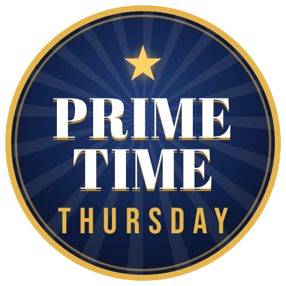 |
| 102 | Six O'Clock Club | 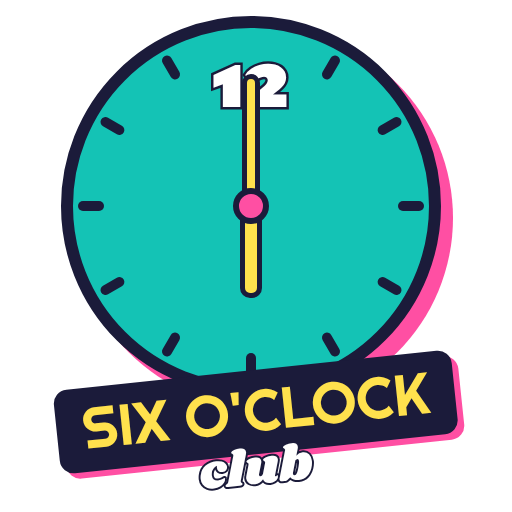 |
| 103 | Noughties | 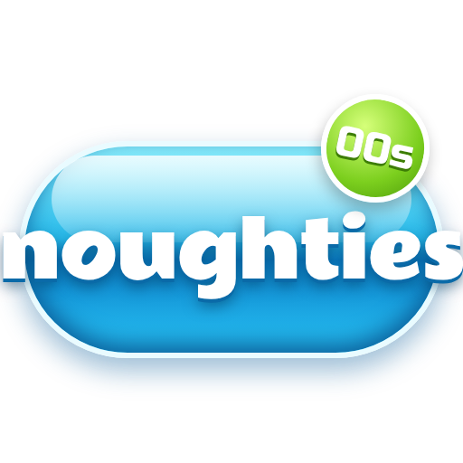 |
| 104 | Cult TV | 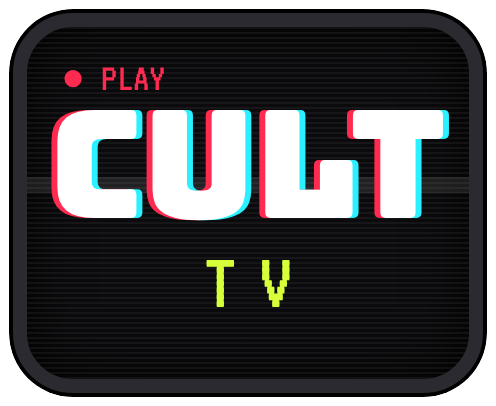 |
| 105 | Telly Gold | 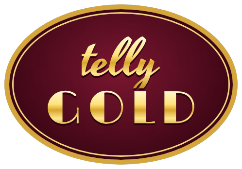 |
| 106 | Sci-Fi Signal |  |
| 107 | Crime Time |  |
| 108 | Toon Late | 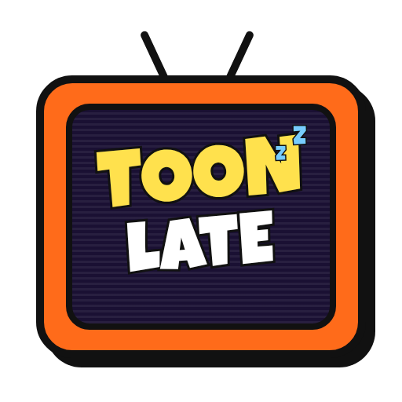 |
| 109 | Friends 24/7 | 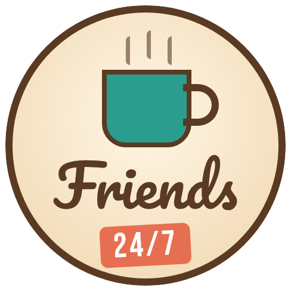 |
| 110 | Reality Check | 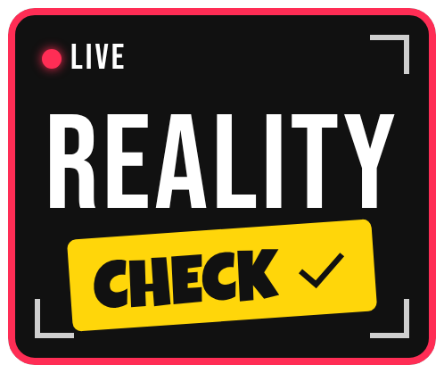 |
| 111 | Tasty TV |  |
| 112 | Wild Planet |  |
| 113 | Hero Hour | 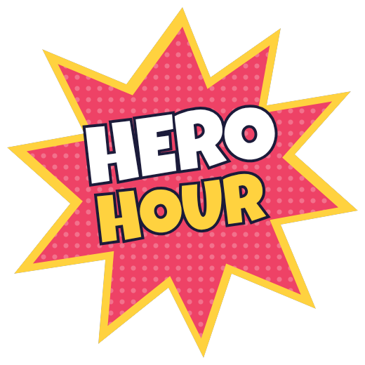 |
| 114 | Hyperspace | 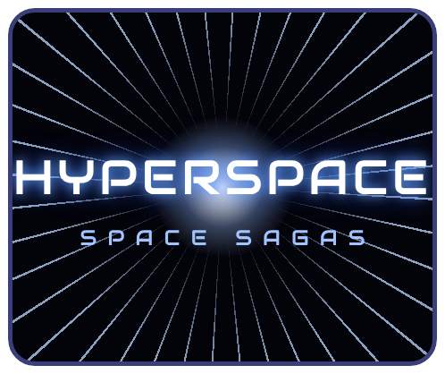 |
| 115 | Box Set | 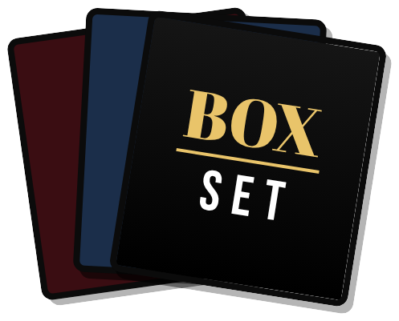 |
| 116 | Sirens | 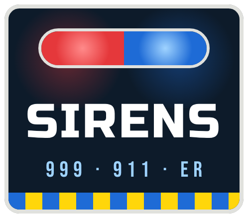 |
| 117 | Sofa Club |  |
| 118 | Realm | 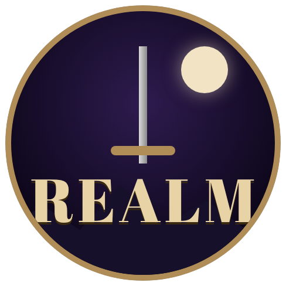 |
| 119 | Homeroom | 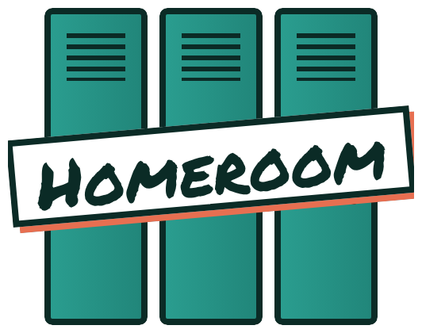 |
| 120 | Sunday Night | 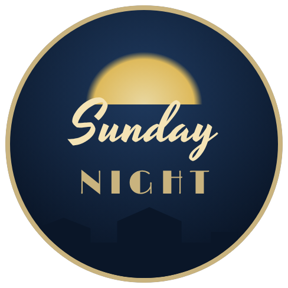 |
| 121 | Case Files | 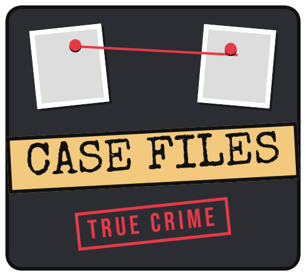 |
| 122 | Frontier | 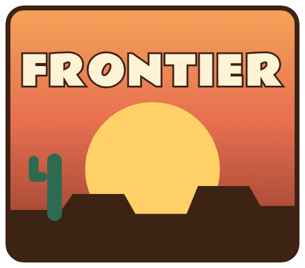 |
| 201 | Late Rental | 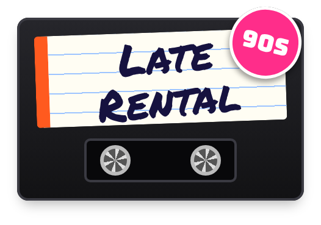 |
| 202 | Y2K Cinema |  |
| 203 | Fright Night | 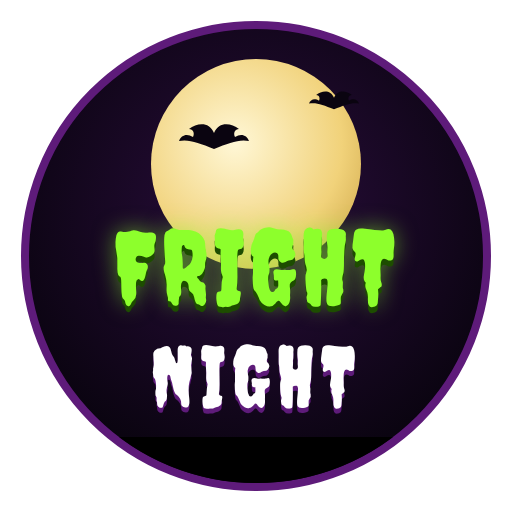 |
| 204 | Rewind Video |  |
| 205 | Silver Screen | 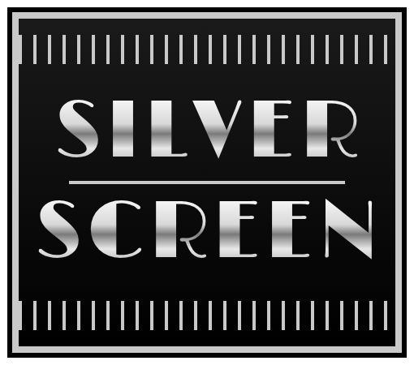 |
| 206 | Award Season |  |
| 207 | Top Shelf |  |
| 208 | Action Stations | 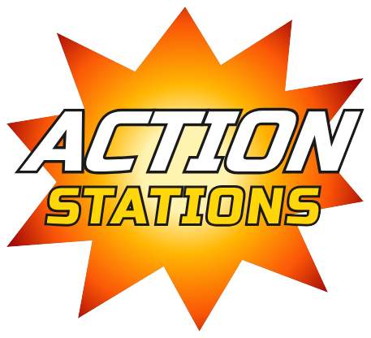 |
| 209 | Date Night |  |
| 210 | Neon 80s | 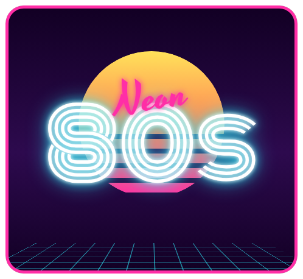 |
| 211 | Doc Club |  |
| 212 | Laugh Track |  |
| 301 | Home Time | 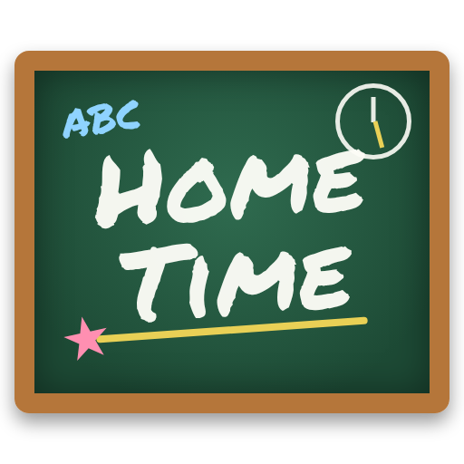 |
| 302 | Saturday Morning | 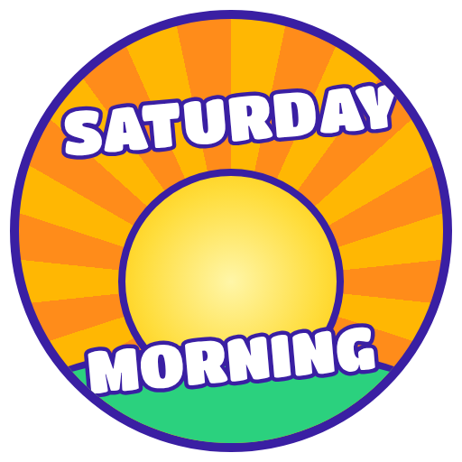 |
| 303 | Family Film Club |  |
| 304 | Pocket Anime | 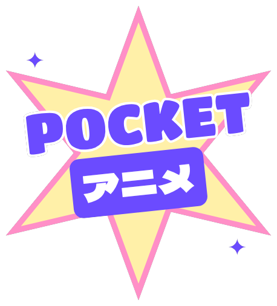 |
| 305 | Happily Ever After |  |
| 306 | Toy Chest | 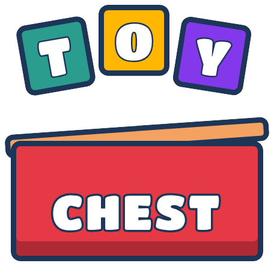 |
| 307 | Cartoon Cinema | 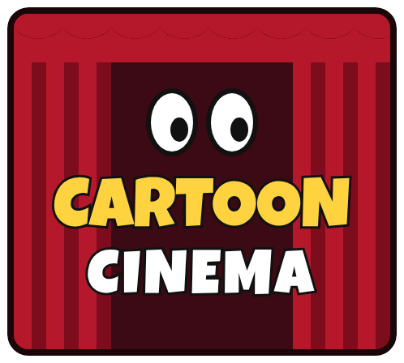 |
| 308 | Wind & Wonder | 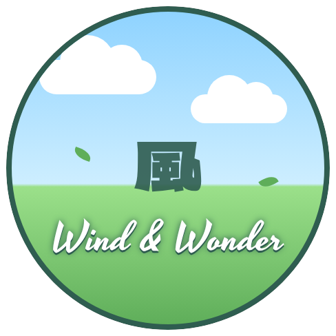 |
| 309 | Goo TV | 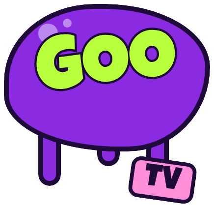 |
| 401 | Neon Tokyo | 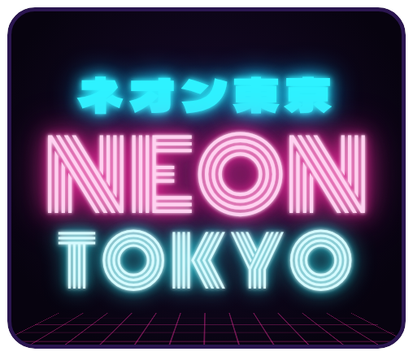 |
| 402 | Midnight Anime |  |
| 501 | Tinsel TV | 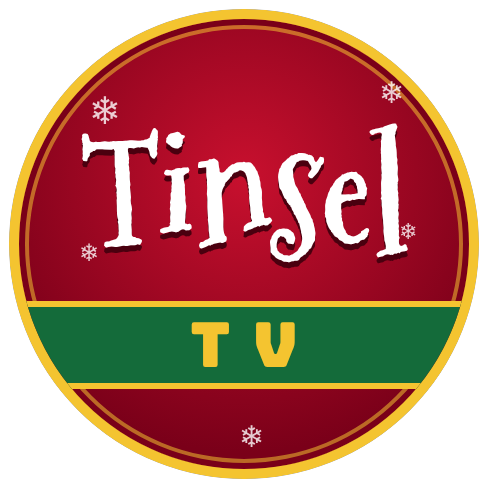 |
| 502 | Spooky Season |  |
| 503 | Countdown | 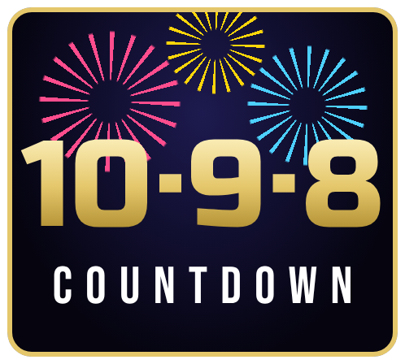 |
| 504 | Be Mine | 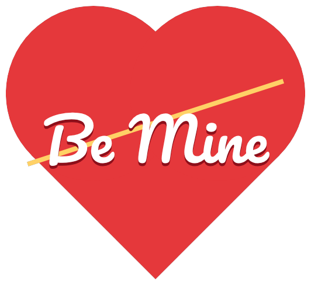 |
| 505 | Leftovers | 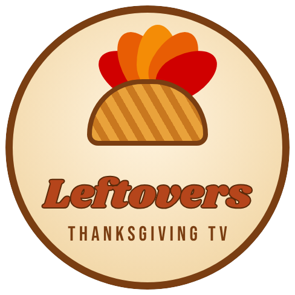 |
| 506 | Summer Hols |  |
